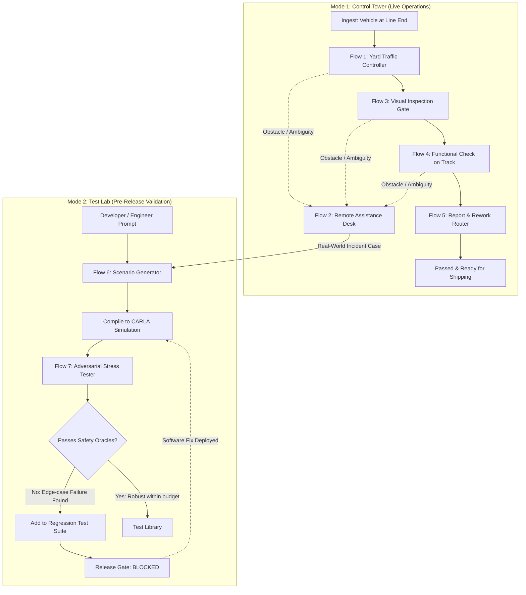

# Marshal: System Architecture, Flow Design, and Dashboard Guide

> **Audience:** Software engineers, system developers, and operators.  
> **Goal:** Explain the Marshal autonomous vehicle operational and testing platform in plain, intuitive software and systems engineering terms—without assuming prior knowledge of automotive manufacturing.

---

## 1. Executive Summary: What is Marshal?

In one sentence: **Marshal is an AI-powered operations supervisor and safety-testing platform for self-driving vehicles.**

### The Core Principle: "Marshal Never Drives"
- **The Self-Driving System Drives:** An external autonomous driving agent (in simulation, CARLA's `BehaviorAgent`) controls the steering, throttle, and braking.
- **Marshal Manages the Ecosystem:** Marshal's Gemini AI agents decide *where* vehicles should go, *assist* vehicles when they encounter obstacles or ambiguity, *verify* physical and functional quality, and *relentlessly stress-test* autonomous driving software before it is deployed.

---

## 2. Automotive Jargon Translated to Software & System Concepts

Car manufacturing uses a lot of specialized terminology. Here is how every concept maps directly to modern software and system architecture:

| Automotive / Factory Term | System / Software Engineering Translation | Plain English Explanation |
| :--- | :--- | :--- |
| **VIN** (Vehicle Identification Number) | `entity_id` / `asset_id` (UUID) | A unique alphanumeric identifier for each individual vehicle instance. |
| **Build Sheet** | Target Configuration Manifest / Desired State | The JSON spec stating what options, colors, and hardware the vehicle *should* have. |
| **Line End** | Ingestion Queue / Pipeline Entry Point | The location where newly assembled vehicles enter the autonomous management system. |
| **Yard** | Fleet Buffer / Storage Depot | The parking area where vehicles wait before delivery or between stages. |
| **Gate Inspection** | Computer Vision Ingestion Filter | A stationary 4-camera scanner that photographs the car to find visual cosmetic flaws or configuration mismatches. |
| **Test Track** | Functional Integration Test Suite (HIL) | A physical/simulated course where the car runs a scripted checklist (turn signals, brake lights, reverse gear, emergency stop). |
| **Disagreement** | Telemetry vs. Sensor Observation Discrepancy | When vehicle internal telemetry says "Light ON", but external cameras observe "Light OFF" (detecting broken hardware or false positive reporting). |
| **Rework Bay** | Remediation Queue / Bug Fix Station | A designated physical workshop where human technicians fix identified defects (paint, electrical, mechanical). |
| **Staging / Loading Bay** | Egress / Dispatch Batch | The loading area where validated vehicles are batched onto transport trucks for shipment. |
| **Scenario Spec** | Declarative Simulation Test Definition | A JSON definition specifying environmental conditions (weather, lighting), vehicle trajectories, and pedestrian/obstacle behaviors. |
| **Release Gate** | CI/CD Deployment Quality Gate | An automated safety check that blocks rolling out new autonomous driving software if regression tests fail. |

---

## 3. The 2 Modes and the Closed-Loop Feedback Cycle

Marshal operates in two interconnected modes that feed into each other in a continuous closed loop:

### Why This Closed Loop is Powerful:
1. **No Incident is Forgotten:** If a car gets confused by a cardboard box near a worker on Tuesday, that exact incident is converted into a structured simulation test by Wednesday.
2. **Adversarial Fuzzing:** The AI doesn't just re-run the exact incident—it mutates lighting, pedestrian speed, and occlusion to find where the driving software completely breaks.
3. **Safety Protection:** The driving system cannot be upgraded or shipped until it proves it can safely handle the newly discovered edge cases.

---

## 4. The 7 Flows Explained in Simple Developer Terms

### Flow 1: Yard Traffic Controller (Fleet Routing & Dispatch)
- **Role:** Directs vehicle movements across the facility via high-level missions (`mission.go`, `mission.hold`, `mission.resume`).
- **Routine Logic (Deterministic Rules):** If distance between cars $\ge 25\text{ m}$ and gate queue $< 2$ vehicles, release the car.
- **When Gemini Steps In:** When unexpected bottlenecks occur (e.g., transport truck delayed 40 minutes, test track blocked, or rework bay full). Gemini calculates trade-offs and proposes re-slotting.
- **Human Authority:** Routine releases happen automatically; multi-vehicle schedule reorganizations require supervisor approval.

### Flow 2: Remote Assistance Desk (Stuck Vehicle Triage)
- **Role:** Unblocks vehicles that stop due to ambiguous obstacles.
- **Trigger:** The driving system encounters an unknown object (e.g., cardboard box on road) and sends `assist.request` with a 10-second video clip and candidate path options.
- **What Gemini Does:** Analyzes the video clip, boxes detected objects and workers, ranks the candidate options, and enforces safety constraints (e.g., *if a human is within 3 meters, only recommend "WAIT"*).
- **Human Authority:** **A human supervisor always makes the final choice.** The car remains stopped until the operator clicks an option. Once resolved, the case is exported to the Test Lab.

### Flow 3: Drive-Through Visual Inspection (Optical Quality Gate)
- **Role:** High-speed computer vision check as the vehicle rolls through an optical gate at 5 km/h.
- **What Gemini Does:**
  1. Inspects 8 body zones for cosmetic defects (scratches, dents, panel alignment).
  2. Compares physical features against the vehicle's **Build Sheet** (e.g., detects if the build sheet specifies *Blue with AWD Badge*, but the car is *Red* or missing the badge).
- **Output:** Categorized verdict: `PASS` ($\text{confidence} > 0.90$), `REVIEW` (human inspects photos), or `FAIL`.

### Flow 4: Functional Check on Test Track (Telemetry vs. Camera Validation)
- **Role:** Verifies electrical, lighting, and mechanical subsystems through an automated routine.
- **What Gemini Does:** Performs **Dual-Source Agreement Checking**.
  - Source A: Vehicle internal telemetry (e.g., CAN bus reporting `left_turn_signal: ACTIVE`).
  - Source B: External CCTV track cameras watching the car.
  - *Gemini compares both.* If telemetry reports "Brake Light ON" but camera footage shows the bulb is dark, it flags a **DISAGREEMENT (Failed Hardware)**.
- **Advantage:** Catches silent electronic failures that self-diagnostics miss.

### Flow 5: Inspection Report & Rework Routing (Remediation Coordinator)
- **Role:** Merges visual findings (Flow 3) and functional checklist results (Flow 4) into a unified vehicle report.
- **What Gemini Does:**
  - If all checks passed: Marks vehicle as `PASS` and clears it for customer dispatch.
  - If defects found: Groups defects by discipline, schedules the appropriate repair bay (e.g., Paint Bay: 20 min, Electrical Bay: 25 min), and routes the vehicle.
- **Key Safety Rule:** Vehicles sent to rework must be re-inspected on failed items before they can ever receive a `PASS` report.

### Flow 6: Scenario Generator (Natural Language to Simulation Spec)
- **Role:** Converts human ideas or operational incident logs into runnable simulation test cases.
- **Process:**
  1. Input: Natural language text (e.g., *"Worker steps out from behind a parked forklift at dusk"*) or an incident from Flow 2.
  2. Gemini drafts a declarative JSON specification referencing validated facility waypoints (`finishing_corner.p3`).
  3. A deterministic compiler translates JSON into executable CARLA Python/ScenarioRunner code.
  4. Runs a dry-run in CARLA. If valid, stores it in the scenario test library.

### Flow 7: Adversarial Test Agent (Safety Fuzzing & Release Gate)
- **Role:** Automatically discovers the exact boundary conditions where the self-driving system fails.
- **How It Works:**
  1. Takes a scenario that the driving system *passes*.
  2. Mutates environment variables: lowers lighting (noon $\to$ dusk $\to$ night), increases pedestrian speed, shrinks trigger distances, or places occluding pallets.
  3. Runs parallel simulations in CARLA.
  4. Deterministic safety oracles measure minimum stopping distance and collision metrics.
  5. When a failure occurs, Gemini isolates the minimal failing parameter delta (e.g., *"Vehicle stops safely at dusk, but fails at night when worker starts within 7 m"*).
  6. Automatically adds the failure to the regression test suite and sets the **Release Gate to BLOCKED**.

---

## 5. Human Authority Matrix

Safety-critical systems require clear boundaries between autonomous AI recommendations and human executive sign-off:

| Operational Decision | AI Agent Capability | Human Operator Authority |
| :--- | :--- | :--- |
| **Routine Vehicle Dispatch** | Executes autonomously via rules | Observes on dashboard |
| **Yard Re-slotting / Area Hold** | Evaluates options and proposes plan | **Must approve** before execution |
| **Stuck Vehicle Assistance** | Analyzes clip and ranks safety options | **Must pick the action** (AI never executes unassisted) |
| **Visual / Functional Pass** | Decides automatically if confidence $> 0.90$ | Can audit and overturn |
| **Send Vehicle to Rework Bay** | Proposes bay and defect summary | **Must confirm** rework ticket |
| **Add Scenario to Test Suite** | Synthesizes and dry-runs spec | **Engineer reviews** spec |
| **Software Release Deployment** | Reports regression pass/fail evidence | **Engineer decides** deployment approval |

---

## 6. Dashboard UX Critique: Why the Current UI Feels Overwhelming

For a developer or user without an automotive manufacturing background, the current dashboard (`/overview`) has several key usability problems:

### Problem 1: Simultaneous Visual Overload
- **3D Canvas + Stream Log + Walkthrough:** The user is immediately greeted by an animated 3D WebGL plant simulation with rotating CCTV angles, an auto-scrolling telemetry feed, a huge 5-scene demo walkthrough card, 6 KPI cards, and multiple tables.
- **Result:** The user doesn't know where to look first. Important alerts get lost in visual noise.

### Problem 2: Domain-Heavy Jargon
- Concepts like *"First-pass yield"*, *"Headway $\ge 25\text{ m}$"*, *"Line-to-yard time"*, and camera codes like *"CAM-LINE-04"* require manufacturing domain context.
- **Better for System Developers:** Translate these into clear system states:
  - *"System Health: Operational"*
  - *"Active Vehicles: 12"*
  - *"Decisions Awaiting Operator: 2"*
  - *"Release Blockers: 1"*

### Problem 3: Blurred Separation Between "Daily Tasks" and "Testing/Simulations"
- In the existing dashboard, live operational queues (stuck cars) are mixed into the same screen space as simulation test lab summaries.
- A clean workflow should clearly organize:
  1. **Action Priority Bar:** What needs attention *right now*?
  2. **Operations Pipeline:** Where are cars currently in the workflow?
  3. **Safety & Test Lab:** Are software builds safe to release?
  4. **Digital Twin / CCTV:** Available on-demand or as an expandable tool, rather than taking up half the primary viewport by default.

---

## 7. Action Plan for the Streamlined Dashboard

To make the dashboard clean, intuitive, and focused for developers and operators:

1. **Top Priority Action Banner (Zero-Cognitive Load):**
   - If there is an open assistance case or pending proposal, display a prominent, high-contrast banner with a single direct button to resolve it.
   - If nothing is pending, show a clean, reassuring green status: *"All automated systems operating normally. Zero pending decisions."*

2. **Visual End-to-End Pipeline Stepper:**
   - Instead of fragmented tables, display a clean horizontal pipeline showing the 4 primary stages:
     $$\text{1. Intake / Yard} \longrightarrow \text{2. Visual Gate} \longrightarrow \text{3. Track Check} \longrightarrow \text{4. Ready for Delivery}$$
     $$\text{Branch: Anomaly / Stuck} \longrightarrow \text{Assistance Desk} \longrightarrow \text{Test Lab Regression}$$
   - Each step shows active vehicle counts and clickable filters.

3. **View Mode Toggle ("Workflow & Decisions" vs. "3D Digital Twin & CCTV"):**
   - **Workflow View (Default):** High-signal, clean, fast. Displays KPI cards, action queues, pipeline state, and lab health.
   - **CCTV & Telemetry View:** Enables the 3D WebGL simulator, live camera feeds, and real-time streaming activity feed for live demonstrations and visual debugging.

4. **Plain Developer Language & Subtitles:**
   - Every metric card and queue item includes a friendly subtitle explaining what it means (e.g., *"Assistance Open: Vehicles paused waiting for human obstacle clearance"*).

5. **Quick Sandbox Links for Developers:**
   - Direct shortcuts to test and verify all 7 flows without getting lost in nested submenus.

